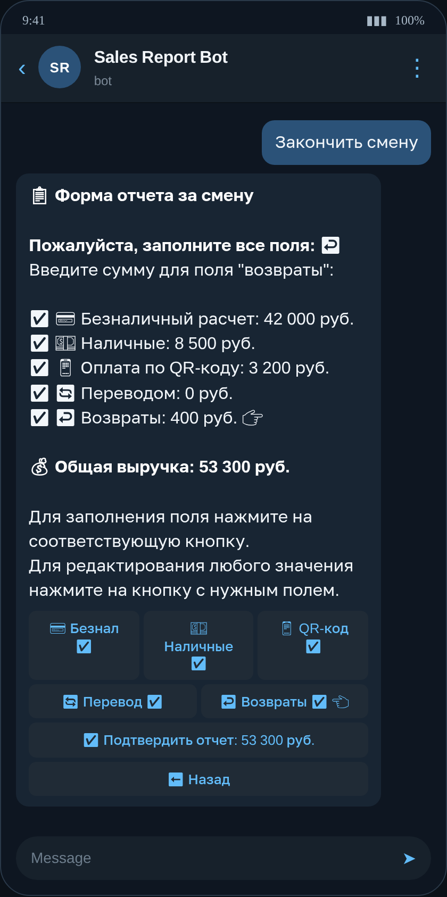

# Sales Report Bot

**Telegram-бот для смен и отчётов о выручке в рознице.**

[](#запуск)
[](#как-это-работает)
[](#как-это-работает)
[](LICENSE)

**[Открыть case study →](https://jefo.github.io/sales-report-bot/)**



---

## Что это

Бот для розничной точки: продавец открывает смену, вечером вводит выручку по способам оплаты, прикладывает четыре фото и закрывает смену. Супервайзер и руководитель смотрят выполнение плана по точкам и продавцам.

Собрал как рабочий прототип интерфейса: без интеграции с 1С и кассой, но с полным сценарием сдачи отчёта и разделением ролей.

---

## Что умеет

### Продавец

- Открывает смену и выбирает точку.
- Вводит отчёт: нал, безнал, QR, перевод, возвраты.
- Видит итоговую выручку и прогресс выполнения плана.
- Может отредактировать любую строку до подтверждения.
- Прикладывает 4 фото подтверждения (подпись, чеки, конверт, запечатанный конверт).
- Закрывает смену или делает экстренное закрытие.
- Смотрит свои показатели и архив по месяцам.
- Открывает рабочие материалы: регламенты, скрипты, информационные файлы.

### Супервайзер и руководитель

- Показатели торговых точек.
- Показатели продавцов.
- Сводный план и факт по всем точкам.
- Рабочие материалы под свою роль.

---

## Сценарий

```mermaid
flowchart TD
    A[/start] --> B[Выбор роли]
    B -->|Продавец| C[Меню продавца]
    C --> D[Начать смену]
    D --> E[Выбрать точку]
    E --> F[Смена активна]
    F --> G[Закончить смену]
    G --> H[Форма отчёта]
    H --> I[4 фото]
    I --> J[Подтверждение]
    J --> K[Смена закрыта]
    C --> L[Мои показатели]
    C --> M[Все для работы]
```

---

## Запуск

Нужен [Bun](https://bun.com) и токен от [@BotFather](https://t.me/BotFather).

```bash
bun install
cp .env.example .env
```

В `.env`:

```env
BOT_TOKEN=123456:AA...
```

```bash
bun run start
```

---

## Структура

```text
src/
├── app/
│   └── mock-data.ts            # точки, продавцы, смены, материалы
├── infra/
│   └── message-builder.ts      # MarkdownV2
└── views/
    └── sales-bot-views.ts      # экраны и клавиатуры
index.ts                        # polling, состояние, маршрутизация
```

---

## Как это работает

- Роль выбирается на старте и определяет набор меню.
- Состояние диалога хранится в `Map<chatId, State>`: шаг, данные отчёта, редактируемое поле, количество фото.
- Форма отчёта обновляется редактированием сообщения, а не десятком новых.
- Суммы валидируются как неотрицательные числа; итог считается как `нал + безнал + QR + перевод − возвраты`.
- Фото принимаются по одному, после четвёртого показывается сводка.
- Показатели считаются из mock-данных: план, факт, процент, остаток, прогресс-бар.

---

## Ограничения

- Все данные — mock. Нет БД, API кассы и загрузки файлов.
- Нет авторизации: роль выбирается вручную, а не выдаётся администратором.
- Нет реального хранения фото: бот только считает, сколько фото пришло.
- Нет интеграции с 1С, эквайрингом и бухгалтерией.
- `seller_1` в статистике захардкожен как текущий продавец.

---

## Что бы добавил дальше

- Postgres и реальные смены/отчёты.
- Авторизацию по номеру телефона или invite-коду.
- Хранение фото в S3 и привязку к отчёту.
- Экспорт в 1С/Google Sheets.
- Напоминание «смена не закрыта» в 21:00.
- Админку для точек, планов и сотрудников.

---

## Лицензия

MIT.
